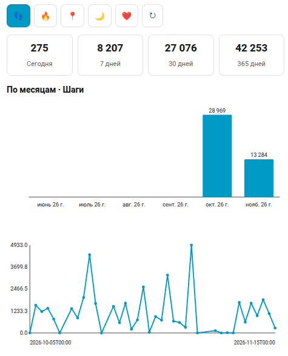

# Widgets Android Home Assistant

[English](../android-template-widgets.md) · [Русский](android-template-widgets.ru.md) · [Français](android-template-widgets.fr.md) · [Lëtzebuergesch](android-template-widgets.lb.md) · [Deutsch](android-template-widgets.de.md) · [Italiano](android-template-widgets.it.md)

Ces exemples concernent le **widget Modèle de Home Assistant Companion sur Android**, et non les cartes Lovelace. Ils utilisent Jinja2 et le rendu HTML limité d’Android.

## Installation

1. Installez et configurez Home Assistant Companion sur Android.
2. Ajoutez le widget **Home Assistant → Modèle** à l’écran d’accueil.
3. Collez l’un des modèles ci-dessous et enregistrez.
4. Remplacez le préfixe des entités par celui de **votre montre**. Consultez Home Assistant → Outils de développement → États.

> **Important:** Le préfixe correspond à une montre particulière. Les suffixes des capteurs de cumul (comme `_2`) peuvent varier. Vérifiez tous les identifiants.

Les balises `<center>`, `<font color="...">`, `<big>`, `<small>`, `<b>` et `<br>` sont prises en charge. Les tableaux HTML, SVG, JavaScript et la plupart des propriétés CSS ne le sont pas. Android peut ignorer `font-stretch` et `letter-spacing`.

## Aperçu des widgets Android


La capture présente les quatre widgets sur l’écran d’accueil Android.

## 1. Pas

Nombre de pas actuel et cumuls sur 7, 30 et 365 jours.

```jinja2







{{ "{:,}".format(v | int).replace(",", " ") }}
—

<center>
<font color="#1976D2"><b><big>👣 Pas</big></b></font><br>
<big><big><font color="#263238"><b>{{ value(t) }}</b></font></big></big><br>
<small><font color="#607D8B">7 jours</font></small><br>
<big><font color="#263238"><b>{{ value(w) }}</b></font></big><br>
<small><font color="#607D8B">30 jours</font></small><br>
<big><font color="#263238"><b>{{ value(m) }}</b></font></big><br>
<small><font color="#607D8B">365 jours</font></small><br>
<big><font color="#263238"><b>{{ value(y) }}</b></font></big>
</center>
```

## 2. Calories

Calories en kcal et cumuls sur les mêmes périodes.

```jinja2







{{ "{:,}".format(v | int).replace(",", " ") }} kcal
—

<center>
<font color="#EF6C00"><b><big>🔥 Calories</big></b></font><br>
<big><big><font color="#263238"><b>{{ value(t) }}</b></font></big></big><br>
<small><font color="#607D8B">7 jours</font></small><br>
<big><font color="#263238"><b>{{ value(w) }}</b></font></big><br>
<small><font color="#607D8B">30 jours</font></small><br>
<big><font color="#263238"><b>{{ value(m) }}</b></font></big><br>
<small><font color="#607D8B">365 jours</font></small><br>
<big><font color="#263238"><b>{{ value(y) }}</b></font></big>
</center>
```

## 3. Distance

Distance en kilomètres et cumuls sur les mêmes périodes.

```jinja2







{{ ("%.1f" | format(v | float)).replace(".", ",") }} km
—

<center>
<font color="#2E7D32"><b><big>📍 Distance</big></b></font><br>
<big><big><font color="#263238"><b>{{ value(t) }}</b></font></big></big><br>
<small><font color="#607D8B">7 jours</font></small><br>
<big><font color="#263238"><b>{{ value(w) }}</b></font></big><br>
<small><font color="#607D8B">30 jours</font></small><br>
<big><font color="#263238"><b>{{ value(m) }}</b></font></big><br>
<small><font color="#607D8B">365 jours</font></small><br>
<big><font color="#263238"><b>{{ value(y) }}</b></font></big>
</center>
```

## Carte d’activité Home Assistant



Il s’agit d’une carte du tableau de bord Home Assistant, pas d’un widget Android.

## 4. Dernier sommeil

Durée, heures de début et de fin, sommeil profond et léger, éveils et frise compacte de 32 blocs. `sleep_json` doit contenir `sleep_date`, `start_time`, `end_time` et `stages` avec `time` et `type`. Codes : **1 = profond, 2 = léger, 3 = éveil/fin**. Dans l’intégration actuelle, `rem_sleep` indique **l’éveil, et non le sommeil paradoxal**.

```jinja2










  
  
    
    
      
    
    
    
  



{{ (v | int) // 60 }} h {{ (v | int) % 60 }} min
—

<center>
<font color="#673AB7"><b><big>🌙 Dernier sommeil</big></b></font><br>
<small><font color="#607D8B">{{ sleep.get('sleep_date', '—') }}</font></small><br>
<big><big><font color="#512DA8"><b>{{ duration(total) }}</b></font></big></big><br>
<small><font color="#607D8B">Début — fin</font></small><br>
<big><font color="#263238"><b>{{ sleep.get('start_time') or '—' }} – {{ sleep.get('end_time') or '—' }}</b></font></big><br>
<small><font color="#607D8B">Sommeil profond</font></small><br>
<big><font color="#1565C0"><b>{{ duration(deep) }}</b></font></big><br>
<small><font color="#607D8B">Sommeil léger</font></small><br>
<big><font color="#00897B"><b>{{ duration(light) }}</b></font></big><br>
<small><font color="#607D8B">Éveils</font></small><br>
<big><font color="#E65100"><b>{{ (awake | int ~ ' min') if is_number(awake) else '—' }}</b></font></big><br>
<small><font color="#607D8B">Phases du sommeil</font></small><br>

  
  
  <small><font style="font-stretch: condensed; letter-spacing: -2px">
  
    
    
    
      
        
      
    
    
      <font color="#1565C0">█</font>
    
      <font color="#00897B">█</font>
    
      <font color="#EF6C00">█</font>
    
  
  </font></small>

  <small><font color="#607D8B">Aucune donnée sur les phases</font></small>

</center>
```

## Carte de sommeil Home Assistant


Le graphique détaillé du tableau de bord est distinct de la frise compacte du widget Android.

### Ajuster la frise compacte

- La frise utilise **32** blocs `█` accolés sans espaces.
- Pour la raccourcir, remplacez `range(32)` et `i / 32` par `range(24)` et `i / 24`.
- Bleu = profond ; turquoise = léger ; orange = éveil.
- La frise est approximative et non une représentation minute par minute.
- Les durées des capteurs peuvent différer des horodatages des phases.
- Android peut ignorer la compression CSS ; réduire le nombre de blocs est plus fiable.

## Dépannage

- **Valeurs inconnues ou tirets :** vérifiez les entités, la synchronisation et les suffixes.
- **Pas de graphique :** vérifiez `sleep_json` sur `last_sleep_details` ; deux phases au minimum sont nécessaires.
- **Retour à la ligne :** réduisez le nombre de blocs ou élargissez le widget.
- **Mise en forme différente :** le moteur HTML Android est limité, contrairement à Lovelace.
- **Confidentialité :** masquez les identifiants, les données de sommeil et les secrets MQTT avant de signaler un problème.
