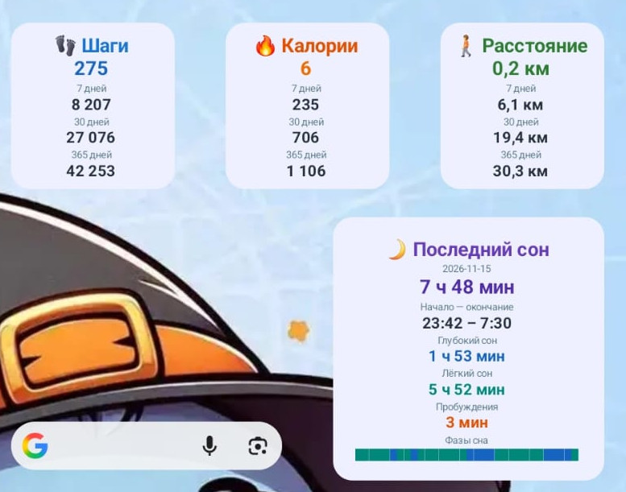

# Android-Widgets fir Home Assistant

[English](../android-template-widgets.md) · [Русский](android-template-widgets.ru.md) · [Français](android-template-widgets.fr.md) · [Lëtzebuergesch](android-template-widgets.lb.md) · [Deutsch](android-template-widgets.de.md) · [Italiano](android-template-widgets.it.md)

Dës Beispiller si fir den **Template-Widget vun der Home Assistant Companion App op Android**, net fir Lovelace-Kaarten. Si benotzen Jinja2 an déi limitéiert HTML-Duerstellung vun Android.

## Ariichtung

1. Installéiert a konfiguréiert d’Home Assistant Companion App op Android.
2. Setzt en **Home Assistant → Template** Widget op den Android-Startbildschierm.
3. Kopéiert eng vun de Schablounen hei ënnen an de Widget a späichert se.
4. Ersetzt de Beispill-Prefix duerch dee vun **ärer Auer**. D’Entitéite fannt Dir ënner Home Assistant → Entwéckler-Tools → Zoustänn.

> **Wichteg:** De Sensor-Prefix gehéiert zu enger bestëmmter Auer. Och Suffixe wéi `_2` kënne variéieren. Kontrolléiert all Entitéits-ID.

Einfach Tags wéi `<center>`, `<font color="...">`, `<big>`, `<small>`, `<b>` an `<br>` funktionéieren. HTML-Tabellen, SVG, JavaScript an déi meescht CSS-Eegeschafte ginn net ënnerstëtzt. Android kann `font-stretch` a `letter-spacing` ignoréieren.

## Android-Widgets um Startbildschierm



D’Bild weist all véier Android-Widgets zesummen.

## 1. Schrëtt

Aktuell Schrëtt an d’Zomme vun de leschte 7, 30 an 365 Deeg.

```jinja2







{{ "{:,}".format(v | int).replace(",", " ") }}
—

<center>
<font color="#1976D2"><b><big>👣 Schrëtt</big></b></font><br>
<big><big><font color="#263238"><b>{{ value(t) }}</b></font></big></big><br>
<small><font color="#607D8B">7 Deeg</font></small><br>
<big><font color="#263238"><b>{{ value(w) }}</b></font></big><br>
<small><font color="#607D8B">30 Deeg</font></small><br>
<big><font color="#263238"><b>{{ value(m) }}</b></font></big><br>
<small><font color="#607D8B">365 Deeg</font></small><br>
<big><font color="#263238"><b>{{ value(y) }}</b></font></big>
</center>
```

## 2. Kalorien

Kalorien a kcal an d’Zomme fir déi selwecht Zäitraim.

```jinja2







{{ "{:,}".format(v | int).replace(",", " ") }} kcal
—

<center>
<font color="#EF6C00"><b><big>🔥 Kalorien</big></b></font><br>
<big><big><font color="#263238"><b>{{ value(t) }}</b></font></big></big><br>
<small><font color="#607D8B">7 Deeg</font></small><br>
<big><font color="#263238"><b>{{ value(w) }}</b></font></big><br>
<small><font color="#607D8B">30 Deeg</font></small><br>
<big><font color="#263238"><b>{{ value(m) }}</b></font></big><br>
<small><font color="#607D8B">365 Deeg</font></small><br>
<big><font color="#263238"><b>{{ value(y) }}</b></font></big>
</center>
```

## 3. Distanz

Distanz a Kilometer an d’Zomme fir déi selwecht Zäitraim.

```jinja2







{{ ("%.1f" | format(v | float)).replace(".", ",") }} km
—

<center>
<font color="#2E7D32"><b><big>📍 Distanz</big></b></font><br>
<big><big><font color="#263238"><b>{{ value(t) }}</b></font></big></big><br>
<small><font color="#607D8B">7 Deeg</font></small><br>
<big><font color="#263238"><b>{{ value(w) }}</b></font></big><br>
<small><font color="#607D8B">30 Deeg</font></small><br>
<big><font color="#263238"><b>{{ value(m) }}</b></font></big><br>
<small><font color="#607D8B">365 Deeg</font></small><br>
<big><font color="#263238"><b>{{ value(y) }}</b></font></big>
</center>
```

## Home Assistant Aktivitéitskaart


Dat ass eng Kaart um Home Assistant Dashboard, keen Android-Widget.

## 4. Leschte Schlof

Dauer, Ufanks- an Ennzäit, Déifschlof, liichte Schlof, Erwächen an eng kompakt Grafik mat 32 Bléck. `sleep_json` muss `sleep_date`, `start_time`, `end_time` a `stages` mat `time` an `type` enthalen. Coden: **1 = déif, 2 = liicht, 3 = erwächt/Enn**. Den aktuelle Sensor `rem_sleep` steet fir **Erwächen, net fir REM-Schlof**.

```jinja2










  
  
    
    
      
    
    
    
  



{{ (v | int) // 60 }} St {{ (v | int) % 60 }} Min
—

<center>
<font color="#673AB7"><b><big>🌙 Leschte Schlof</big></b></font><br>
<small><font color="#607D8B">{{ sleep.get('sleep_date', '—') }}</font></small><br>
<big><big><font color="#512DA8"><b>{{ duration(total) }}</b></font></big></big><br>
<small><font color="#607D8B">Ufank — Enn</font></small><br>
<big><font color="#263238"><b>{{ sleep.get('start_time') or '—' }} – {{ sleep.get('end_time') or '—' }}</b></font></big><br>
<small><font color="#607D8B">Déifschlof</font></small><br>
<big><font color="#1565C0"><b>{{ duration(deep) }}</b></font></big><br>
<small><font color="#607D8B">Liichte Schlof</font></small><br>
<big><font color="#00897B"><b>{{ duration(light) }}</b></font></big><br>
<small><font color="#607D8B">Erwächen</font></small><br>
<big><font color="#E65100"><b>{{ (awake | int ~ ' Min') if is_number(awake) else '—' }}</b></font></big><br>
<small><font color="#607D8B">Schlofphasen</font></small><br>

  
  
  <small><font style="font-stretch: condensed; letter-spacing: -2px">
  
    
    
    
      
        
      
    
    
      <font color="#1565C0">█</font>
    
      <font color="#00897B">█</font>
    
      <font color="#EF6C00">█</font>
    
  
  </font></small>

  <small><font color="#607D8B">Keng Donnéeën iwwer Schlofphasen</font></small>

</center>
```

## Home Assistant Schlofkaart


Déi detailléiert Schlofgrafik um Dashboard ass net datselwecht wéi déi kompakt Android-Grafik.

### Kompakt Grafik upassen

- D’Grafik benotzt **32** breet `█`-Bléck ouni Ofstänn.
- Fir se méi kuerz ze maachen, ersetzt `range(32)` an `i / 32` duerch `range(24)` an `i / 24`.
- Blo = Déifschlof; türkis = liichte Schlof; orange = erwächt.
- D’Grafik ass eng ongeféier Duerstellung, net Minutt fir Minutt.
- D’Daueren aus de Sensoren an d’Zäite vun de Phase kënnen ofwäichen.
- Android kann d’CSS-Kompressioun ignoréieren; manner Bléck si méi zouverlässeg.

## Problemer léisen

- **Onbekannt Wäerter oder Strécher:** kontrolléiert d’Entitéits-IDen, d’Synchronisatioun an d’Suffixen.
- **Keng Schlofgrafik:** kontrolléiert `sleep_json` beim `last_sleep_details`; mindestens zwou Phasen si néideg.
- **Grafik brécht ëm:** reduzéiert d’Zuel vun de Bléck oder vergréissert de Widget.
- **Aner Formatéierung:** den Android-HTML-Renderer ass méi limitéiert wéi Lovelace.
- **Dateschutz:** verstoppt Auer-IDen, Schlofdonnéeën a MQTT-Passwierder an ëffentleche Feelerberichter.
