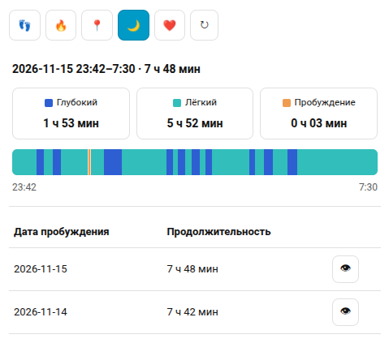

# Android-виджеты Home Assistant

[English](../android-template-widgets.md) · [Русский](android-template-widgets.ru.md) · [Français](android-template-widgets.fr.md) · [Lëtzebuergesch](android-template-widgets.lb.md) · [Deutsch](android-template-widgets.de.md) · [Italiano](android-template-widgets.it.md)

Примеры предназначены для **Home Assistant Companion → Android → виджет «Шаблон»**, а не для карточек Lovelace. Используются шаблоны Jinja2 и ограниченное HTML-форматирование Android.

## Установка

1. Установите и настройте приложение Home Assistant Companion на Android.
2. Добавьте на рабочий стол Android виджет **Home Assistant → Шаблон**.
3. Вставьте один из приведённых ниже шаблонов в поле виджета и сохраните.
4. Замените префикс датчиков на префикс **своих часов**. Идентификаторы доступны в Home Assistant → Инструменты разработчика → Состояния.

> **Важно:** Префикс датчиков относится к конкретным часам. Суффиксы датчиков сумм (например, `_2`) тоже могут отличаться. Проверьте все идентификаторы.

Поддерживаются основные теги `<center>`, `<font color="...">`, `<big>`, `<small>`, `<b>`, `<br>`. HTML-таблицы, SVG, JavaScript и большинство CSS-свойств не работают. Android может игнорировать `font-stretch` и `letter-spacing`.

## Виджеты на рабочем столе Android


На снимке показаны все четыре Android-виджета.

## 1. Шаги

Шаги и суммы за последние 7, 30 и 365 дней.

```jinja2







{{ "{:,}".format(v | int).replace(",", " ") }}
—

<center>
<font color="#1976D2"><b><big>👣 Шаги</big></b></font><br>
<big><big><font color="#263238"><b>{{ value(t) }}</b></font></big></big><br>
<small><font color="#607D8B">7 дней</font></small><br>
<big><font color="#263238"><b>{{ value(w) }}</b></font></big><br>
<small><font color="#607D8B">30 дней</font></small><br>
<big><font color="#263238"><b>{{ value(m) }}</b></font></big><br>
<small><font color="#607D8B">365 дней</font></small><br>
<big><font color="#263238"><b>{{ value(y) }}</b></font></big>
</center>
```

## 2. Калории

Калории (ккал) и суммы за выбранные периоды.

```jinja2







{{ "{:,}".format(v | int).replace(",", " ") }} ккал
—

<center>
<font color="#EF6C00"><b><big>🔥 Калории</big></b></font><br>
<big><big><font color="#263238"><b>{{ value(t) }}</b></font></big></big><br>
<small><font color="#607D8B">7 дней</font></small><br>
<big><font color="#263238"><b>{{ value(w) }}</b></font></big><br>
<small><font color="#607D8B">30 дней</font></small><br>
<big><font color="#263238"><b>{{ value(m) }}</b></font></big><br>
<small><font color="#607D8B">365 дней</font></small><br>
<big><font color="#263238"><b>{{ value(y) }}</b></font></big>
</center>
```

## 3. Расстояние

Расстояние (км) и суммы за выбранные периоды.

```jinja2







{{ ("%.1f" | format(v | float)).replace(".", ",") }} км
—

<center>
<font color="#2E7D32"><b><big>📍 Расстояние</big></b></font><br>
<big><big><font color="#263238"><b>{{ value(t) }}</b></font></big></big><br>
<small><font color="#607D8B">7 дней</font></small><br>
<big><font color="#263238"><b>{{ value(w) }}</b></font></big><br>
<small><font color="#607D8B">30 дней</font></small><br>
<big><font color="#263238"><b>{{ value(m) }}</b></font></big><br>
<small><font color="#607D8B">365 дней</font></small><br>
<big><font color="#263238"><b>{{ value(y) }}</b></font></big>
</center>
```

## Карточка активности Home Assistant


Это карточка панели Home Assistant, а не Android-виджет.

## 4. Последний сон

Продолжительность, время начала и окончания, глубокий и лёгкий сон, пробуждения и компактный график из 32 блоков. Атрибут `sleep_json` должен содержать `sleep_date`, `start_time`, `end_time`, `stages` с `time` и `type`. Коды фаз: **1 — глубокий, 2 — лёгкий, 3 — пробуждение/окончание**. В текущей интеграции `rem_sleep` используется для **пробуждений, а не REM-сна**.

```jinja2










  
  
    
    
      
    
    
    
  



{{ (v | int) // 60 }} ч {{ (v | int) % 60 }} мин
—

<center>
<font color="#673AB7"><b><big>🌙 Последний сон</big></b></font><br>
<small><font color="#607D8B">{{ sleep.get('sleep_date', '—') }}</font></small><br>
<big><big><font color="#512DA8"><b>{{ duration(total) }}</b></font></big></big><br>
<small><font color="#607D8B">Начало — окончание</font></small><br>
<big><font color="#263238"><b>{{ sleep.get('start_time') or '—' }} – {{ sleep.get('end_time') or '—' }}</b></font></big><br>
<small><font color="#607D8B">Глубокий сон</font></small><br>
<big><font color="#1565C0"><b>{{ duration(deep) }}</b></font></big><br>
<small><font color="#607D8B">Лёгкий сон</font></small><br>
<big><font color="#00897B"><b>{{ duration(light) }}</b></font></big><br>
<small><font color="#607D8B">Пробуждения</font></small><br>
<big><font color="#E65100"><b>{{ (awake | int ~ ' мин') if is_number(awake) else '—' }}</b></font></big><br>
<small><font color="#607D8B">Фазы сна</font></small><br>

  
  
  <small><font style="font-stretch: condensed; letter-spacing: -2px">
  
    
    
    
      
        
      
    
    
      <font color="#1565C0">█</font>
    
      <font color="#00897B">█</font>
    
      <font color="#EF6C00">█</font>
    
  
  </font></small>

  <small><font color="#607D8B">Нет данных о фазах сна</font></small>

</center>
```

## Карточка сна Home Assistant



Подробный график сна на панели Home Assistant отличается от компактной шкалы Android.

### Настройка компактного графика

- График состоит из **32** широких символов `█` без пробелов.
- Чтобы уменьшить ширину, замените `range(32)` и `i / 32` на `range(24)` и `i / 24`.
- Синий — глубокий сон, бирюзовый — лёгкий, оранжевый — пробуждение.
- График приблизительный, а не поминутный.
- Длительности в датчиках и временные отметки фаз могут различаться.
- Android может игнорировать CSS-сжатие; надёжнее уменьшать количество блоков.

## Решение проблем

- **Прочерки или неизвестные значения:** проверьте ID датчиков, синхронизацию и суффиксы.
- **Нет графика сна:** проверьте `sleep_json` датчика `last_sleep_details`; нужно минимум две отметки.
- **График переносится:** уменьшите число блоков или увеличьте ширину виджета.
- **Форматирование отличается:** Android-виджет не поддерживает оформление Lovelace.
- **Конфиденциальность:** скрывайте ID часов, историю сна и пароли MQTT при публикации отчётов.
